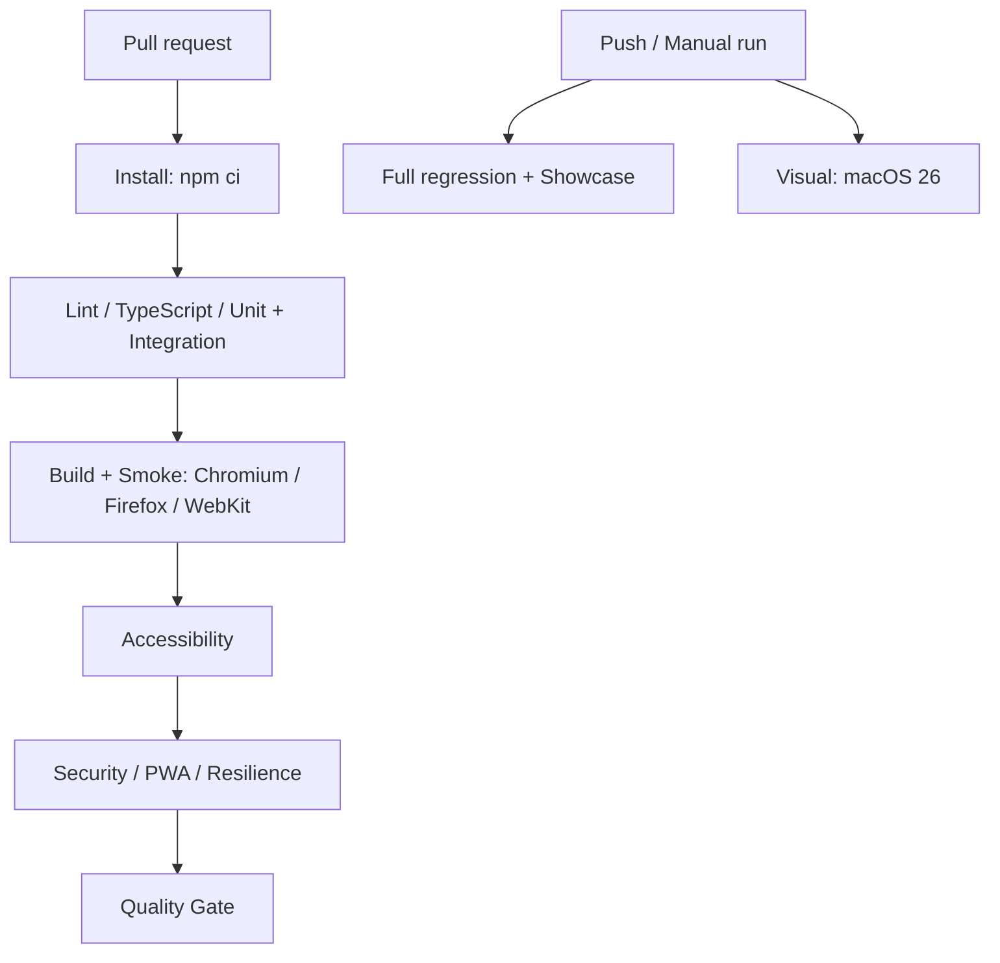

# Jedna kula — Quality Engineering na prawdziwej PWA

**Portfolio: Senior QA Automation Engineer · SDET · Quality Engineer · AI-assisted QA Engineer**

Zawodnik kończy trening na boisku, traci internet i zamyka telefon. Po powrocie wynik powinien nadal być w historii. Ten projekt pokazuje, jak przełożyć takie wymaganie na strategię testów, sprawdzić rzeczywisty zapis w przeglądarce i udowodnić zachowanie aplikacji również wtedy, gdy pamięć odmawia współpracy.

Jedna kula to działająca aplikacja do treningu pétanque: React, TypeScript, IndexedDB i PWA z service workerem. Jej jakość sprawdzają testy logiki, integracji, interfejsu, offline, dostępności, obrazu i bezpieczeństwa. Osobna demonstracja pokazuje kontrolowany proces AI-assisted QA.

**Zacznij od:** [strategii testów](docs/TEST_STRATEGY.md), [scenariuszy showcase](#quality-engineering) lub [opisu aplikacji dla gracza](docs/APLIKACJA.md).

## Quality Engineering

**25 reprezentatywnych scenariuszy, każdy z określonym ryzykiem i celem.** Showcase można uruchomić jednym poleceniem. Szersza regresja pozostaje osobnym zestawem do weryfikacji całego produktu.

Cztery główne E2E wydzielono z istniejących przepływów; wykorzystano również dotychczasowy test błędu pamięci. Nowe scenariusze uzupełniają konkretne luki: integrację warstw, granice bezpieczeństwa, opóźniony zapis, rzeczywiste porównania wizualne i ograniczenia pracy agentów.

### Co można sprawdzić w kodzie

- **E2E — 4 scenariusze.** Puenta prowadzi od rzutów do zapisanej historii i statystyk. Strzał pod presją rozróżnia usunięcie celu od dotknięcia. Zaliczona lekcja oraz profil przetrwają ponowne otwarcie. [Przepływy użytkownika](tests/e2e/app.spec.ts).
- **Integration — 3 scenariusze.** Silnik punktacji współpracuje z repozytorium i statystykami; moduł mentalny zachowuje samoocenę i postęp; import atomowo zastępuje stan i zachowuje kopię poprzednich danych. Vitest i fake-indexeddb sprawdzają te kontrakty bez kosztu UI. [Integracje](tests/integration/training.test.ts).
- **PWA / offline — 3 scenariusze.** Testy pracują na produkcyjnym buildzie, czekają na prawdziwy controller service workera, sprawdzają cache i manifest, wyłączają sieć oraz zapisują trening. Ponowne otwarcie strony w tym samym kontekście potwierdza trwałość szkicu i wyniku. [Offline](tests/pwa/offline.spec.ts).
- **Accessibility — 2 scenariusze.** Axe-core bada krytyczne widoki; dodatkowe asercje sprawdzają skip link, fokus, dostępne nazwy i aktywację klawiaturą. [Dostępność](tests/accessibility/critical.spec.ts).
- **Visual regression — 2 scenariusze.** Dashboard i aktywna sesja są porównywane z zapisanymi PNG. Kontrolowany zegar, viewport i reduced motion ograniczają zmienność. Różnica obrazu wymaga oceny; CI nie aktualizuje wzorców. [Porównania wizualne](tests/visual/critical.spec.ts).
- **Application security — 3 scenariusze.** Nazwa podobna do payloadu XSS pozostaje tekstem, uszkodzony IndexedDB daje kontrolowany alert, a sfałszowana punktacja w imporcie nie zastępuje danych użytkownika. [Granice danych](tests/security/input.spec.ts).
- **Agent security — 4 scenariusze.** Instrukcje w stronie, repozytorium i danych użytkownika pozostają niezaufanymi danymi. Broker odmawia nieprzyznanych capabilities, w tym shell i network, przed wywołaniem adaptera. [Kontrakty brokera](tests/agent-security/boundaries.test.ts).
- **AI-assisted testing — 2 scenariusze.** Generator tworzy wykonywalny test z planu i zgodnego rekordu review. Kontrola healera blokuje zmianę oczekiwanego zachowania i oddziela product bug od test bug. [Wykonywany test](tests/agentic/generated/mental.spec.ts) · [kontrola review](tests/agentic/review.test.ts).
- **Resilience — 2 scenariusze.** `QuotaExceededError` pozwala ponowić zapis bez utraty próby. Wstrzymanie potwierdzenia rzeczywistej transakcji sprawdza, czy szybkie wielokrotne kliknięcia nie tworzą duplikatów. Synchronizacja opiera się na stanie aplikacji i jawnym sygnale. [Opóźniony zapis](tests/resilience/commit.spec.ts).

### Decyzje inżynierskie, które stoją za testami

**Dobór poziomu testu do ryzyka.** Punktację i współpracę modeli weryfikuje Vitest. Przeglądarka sprawdza to, co wymaga rzeczywistego renderowania, IndexedDB, nawigacji, fokusu lub service workera. Przypadki różniące się wyłącznie dystansem pozostają na niższym poziomie testów.

**Kontrolowana awaria zamiast szczęśliwego przebiegu.** Test opóźnionego zapisu zatrzymuje potwierdzenie transakcji do sygnału z testu. Pozwala sprawdzić blokadę interfejsu i liczbę zapisanych prób dokładnie w momencie, w którym pojawia się ryzyko race condition.

**Stabilność zaprojektowana w suite.** Nowy browser context per test, unikalne bazy integracyjne, deterministyczne dane, locatory oparte na role/name/label i oczekiwanie na zakończony zapis. Showcase ma `retries: 0` i nie używa hard-coded sleeps. Wybrane krytyczne scenariusze można powtarzać osobnym poleceniem.

**Mała warstwa wsparcia.** Typowane helpery upraszczają przygotowanie treningu, danych i persystencji. Testy zachowują czytelny przebieg oraz widoczne asercje. [Helpery i kontrakty](tests/support).

**Cross-browser według priorytetu.** Pełny zestaw przeglądarkowy działa na Chromium z emulacją Pixel 7. Smoke zapisu puenty jest dodatkowo wykonywany na desktop Chromium, Firefox i WebKit z ekranem iPhone 13. Jeden krytyczny kontrakt jest sprawdzany na trzech silnikach bez powielania całej suite.

### Testowanie doprowadziło również do poprawy produktu

Analiza bezpieczeństwa ujawniła brak walidacji danych odczytywanych z IndexedDB przed renderowaniem. Dodano walidację stanu i czytelny alert. Uszkodzone dane pozostają w bazie, a test potwierdza brak nieobsłużonego błędu strony i zachowanie zapisu. [Implementacja persystencji](src/storage.ts) · [scenariusz regresyjny](tests/security/input.spec.ts).

To przykład pracy od zidentyfikowanego ryzyka, przez poprawkę w aplikacji, do powtarzalnego dowodu jej działania.

### Wyniki ostatniej pełnej weryfikacji

**12.10.2026, lokalnie:**

- Showcase: **8/8 Vitest + 20/20 wykonań Playwright**. To 25 różnych scenariuszy oraz trzy dodatkowe wykonania smoke na innych projektach przeglądarkowych.
- Szersza regresja: **109/109 Vitest + 47/47 Playwright**. Osiem kontraktów showcase wchodzi również do tego zestawu Vitest.
- Smoke i resilience powtórzone pięć razy: **15/15, bez retry**.
- Porównania wizualne przeszły z zapisanymi baseline, bez ich aktualizacji.
- TypeScript, ESLint i produkcyjny build PWA: poprawne.

Wyniki są zapisanym stanem weryfikacji, nie deklaracją ciągłego statusu CI. [Szczegóły środowiska i zakresu](docs/TEST_STRATEGY.md).

### CI/CD — quality gate i wdrożenie

Workflow [GitHub Actions](.github/workflows/quality.yml) jest skonfigurowany dla pull requestów, push do main/master i uruchomienia manualnego.



Workflow ma read-only permissions, izolowane joby i concurrency. Po failure zachowuje HTML report, trace oraz screenshots przez 7 dni. Visual działa w osobnym jobie macOS; wzorce nie są aktualizowane automatycznie. Publikacja aplikacji pozostaje osobną operacją.

**Pierwszy przebieg GitHub Actions, 12.10.2026:** [pełna regresja i showcase przeszły](https://github.com/logip87/jedna-kula/actions/runs/38235390349/job/114764685112), a [visual potwierdził zgodność baseline z hosted runnerem](https://github.com/logip87/jedna-kula/actions/runs/38235390349/job/114764684918). Quality gate zaliczył lint, TypeScript, Vitest i kontrolę generatora, lecz został przerwany limitem 15 minut podczas instalacji przeglądarek. Nie oznacza to zielonego całego pipeline. Instalacja ma teraz osobny limit 5 minut, aby problem infrastruktury był widoczny wcześniej. [Aktualne przebiegi CI](https://github.com/logip87/jedna-kula/actions/workflows/quality.yml).

**Delivery:** aplikację publikuje lokalne `npm run deploy` przez FTPS, z hasłem w Pęku kluczy i kopią zastępowanych plików. Workflow CI nie wdraża na serwer. Wdrożenie automatyczne z GitHub Actions wymagałoby osobnego joba zależnego od poprawnych checków oraz konfiguracji sekretów i środowiska produkcyjnego. Obecny zakres briefu wymaga automatycznego CI; deployment pozostaje ręcznie uruchamiany.

### AI-assisted QA z jawną granicą odpowiedzialności

Demonstracja używa lokalnych fixtures i syntetycznego planu/review. Generator rzeczywiście tworzy plik TypeScript, który Playwright wykonuje przeciwko aplikacji. Digest wykrywa zmianę planu; nie zastępuje autoryzacji ani review człowieka.

Healer może przedstawić propozycję wraz z dowodami. Nie zapisuje zmian, nie usuwa asercji i nie zmienia oczekiwanego zachowania, aby uzyskać zielony pipeline. Potencjalny błąd produktu pozostaje osobnym problemem do rozpatrzenia.

Testy agent security sprawdzają ograniczenia narzędzi i granice zaufania. Nie są oceną zachowania żywego modelu AI. [Przebieg, guardrails i healer safety](docs/AGENTIC_TESTING.md).

### Uruchom showcase

Wymagany Node.js 22.12+; ostatnią weryfikację wykonano na Node 24.

```sh
npm ci
npx playwright install chromium firefox webkit
npm run qa:showcase
```

Poszczególne obszary:

```sh
npm run qa:contracts      # integracje i kontrakty agentowe, bez przeglądarki
npm run qa:smoke          # krytyczny flow na Chromium, Firefox i WebKit
npm run qa:pwa
npm run qa:a11y
npm run qa:visual         # dwa porównania PNG; baseline macOS
npm run qa:security
npm run qa:agent-security
npm run qa:agentic
npm run qa:resilience
npm run qa:repeat         # pięć przebiegów smoke + resilience
npm run qa:generate:check # kontrola zgodności testu z planem/review
```

Na Linux funkcjonalny showcase działa bez dwóch testów visual; porównania obrazów mają osobny job macOS. Aktualizacja baseline jest świadomą operacją: `npm run qa:visual -- --update-snapshots`, po której trzeba ocenić diff.

Pełna weryfikacja produktu:

```sh
npm run typecheck
npm run lint
npm test
npm run test:e2e
npm run build
```

### Co pozostaje do sprawdzenia ręcznie

Automatyczne axe-core uzupełnia testowanie dostępności; nie zapewnia pełnej zgodności WCAG. Ręczne pozostają czytniki ekranu, instalacja na fizycznych telefonach oraz aktualizacja workera między dwoma rzeczywistymi wdrożeniami. Harness agentowy nie wykonuje prawdziwych ataków i nie odczytuje sekretów.

Zasady triage, retry i ewentualnej quarantine opisuje [FLAKINESS.md](docs/FLAKINESS.md).

## Aplikacja, na której pracują testy

Jedna kula łączy 30 ćwiczeń technicznych, trening mentalny, decyzje meczowe i postęp oparty na zapisanych wynikach. Działa bez konta, a po przygotowaniu cache także offline. Jest przeznaczona przede wszystkim dla dorosłych graczy rekreacyjnych, klubowych i turniejowych; juniorzy mają dostęp do tych samych funkcji.

[Poznaj aktualne możliwości i cele aplikacji z perspektywy gracza](docs/APLIKACJA.md).

## Uruchomienie aplikacji

```sh
npm ci
npm run dev
```

Wersja developerska: http://localhost:5173. Produkcyjny podgląd PWA:

```sh
npm run build
npm run preview
```

Podgląd: http://localhost:4173. Instalacja na telefonie wymaga HTTPS. Playwright sam buduje i uruchamia podgląd produkcyjny.

## Technologia i dokumentacja

React · TypeScript · Vite · Tailwind CSS · React Router · IndexedDB (`idb`) · Workbox · Vitest · Playwright · axe-core.

- [Strategia testów i ryzyka](docs/TEST_STRATEGY.md)
- [Proces AI-assisted testing](docs/AGENTIC_TESTING.md)
- [Stabilność i obsługa failure](docs/FLAKINESS.md)
- [Opis aplikacji dla gracza](docs/APLIKACJA.md)
- [PRD](docs/PRD.md)
- [Architektura](docs/ARCHITECTURE.md)
- [Zadania i wyniki weryfikacji](docs/TASKS.md)
- [Źródła przepisów](docs/RULES_SOURCES.md)
- [Formularz kontaktowy](docs/FEEDBACK.md)

Statyczne wdrożenie: `dist/` przez HTTPS, ze SPA fallback do `index.html`. Skrypt FTPS `scripts/cal-ftp.py` przechowuje hasło w Pęku kluczy i kopie zastępowanych plików w `release/`. Dane treningowe pozostają lokalne; formularz zgłoszeń wysyła wyłącznie treść świadomie wpisaną przez użytkownika i opcjonalny e-mail.
