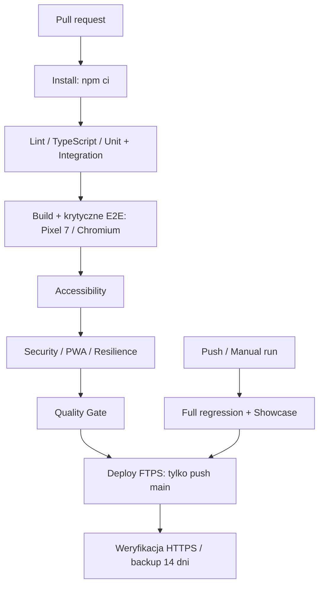

# Jedna kula — PWA do treningu pétanque

Jedna kula to działająca aplikacja do samodzielnego treningu pétanque. Pomaga wybrać ćwiczenie, zapisać serię rzutów, wrócić do rozpoczętego treningu i śledzić postęp. Działa lokalnie w przeglądarce: React, TypeScript, IndexedDB oraz PWA z service workerem.

Wyniki i szkice zostają na urządzeniu. Po przygotowaniu cache aplikacja działa również bez sieci. Testy automatyczne skupiają się na krytycznych zachowaniach produktu: zapisie treningu, trwałości danych, działaniu offline, dostępności i ochronie lokalnych danych.

**Od grania do trenowania.** Produkt jest skierowany przede wszystkim do ambitnych graczy klubowych, juniorów oraz osób początkujących i średniozaawansowanych, które potrzebują struktury treningu. [Pozycjonowanie i persona](docs/POSITIONING.md).

**Zacznij od:** [strategii testów](docs/TEST_STRATEGY.md), [opisu aktualnego zestawu testów](#testy-i-automatyczna-kontrola-jakości) lub [opisu aplikacji dla gracza](docs/APLIKACJA.md).

## Co robi aplikacja

- **Prowadzi trening techniczny.** Biblioteka ćwiczeń obejmuje puentę, strzał, lob, grę przy linii i trening mieszany. Gracz wybiera warunki serii, wpisuje wyniki rzutów i może wznowić przerwany trening.
- **Pomaga wybrać następny krok.** Po zapisanych seriach pokazuje rekomendacje oparte na porównywalnych wynikach, trendzie i czasie od ostatniego treningu. Bez historii proponuje spokojny punkt startowy, a pełna biblioteka pozostaje zawsze dostępna.
- **Układa naukę w ścieżkę.** Przygoda z pétanque prowadzi przez misje treningowe i pokazuje aktualne zadanie, najbliższe etapy oraz postęp. Misje budują bazę, a rekomendacje korzystają ze zwykłych zapisanych serii.
- **Rozwija także poza samym rzutem.** Moduły mentalne, krótkie ćwiczenia praktyczne i „Ciało do gry” wspierają rutynę, koncentrację oraz spokojne przygotowanie ruchowe. Rozpoczęte moduły można wznowić, a fizyczny trening ma historię i propozycję na dziś.
- **Ćwiczy decyzje meczowe.** Plansze taktyczne i tryb meczowy pozwalają przeanalizować sytuację, wybrać zagranie oraz zachować własną decyzję i wynik rozgrywki.
- **Pokazuje postęp bez konta.** Historia, statystyki, rekordy i kopie JSON działają lokalnie na urządzeniu; po przygotowaniu cache aplikacja jest dostępna offline.

## Testy i automatyczna kontrola jakości

Zestaw nie próbuje automatyzować każdej kombinacji w interfejsie. Logika i warianty domenowe są sprawdzane w Vitest, a Playwright uruchamia pięć najważniejszych przepływów użytkownika na emulowanym Pixelu 7 w Chromium. Dodatkowy zestaw przeglądarkowy weryfikuje offline, dostępność, granice danych i opóźniony zapis.

### Co można sprawdzić w kodzie

- **Krytyczne E2E — 5 scenariuszy.** Gracz może rozpocząć, cofnąć, wznowić i zapisać trening; postęp lekcji mentalnej, modułu ruchowego, misji Przygody i decyzji taktycznej przetrwa odświeżenie. [Przepływy użytkownika](tests/e2e/critical).
- **Unit i integration.** Vitest sprawdza punktację, rekomendacje, progres, wybór treningu, zapis danych i współpracę modułów bez kosztu uruchamiania przeglądarki. [Testy integracyjne](tests/integration).
- **PWA / offline — 3 scenariusze.** Testy pracują na produkcyjnym buildzie, czekają na prawdziwy controller service workera, sprawdzają cache i manifest, wyłączają sieć oraz zapisują trening. Ponowne otwarcie strony w tym samym kontekście potwierdza trwałość szkicu i wyniku. [Offline](tests/pwa/offline.spec.ts).
- **Accessibility — 2 scenariusze.** Axe-core bada krytyczne widoki; dodatkowe asercje sprawdzają skip link, fokus, dostępne nazwy i aktywację klawiaturą. [Dostępność](tests/accessibility/critical.spec.ts).
- **Application security — 3 scenariusze.** Nazwa podobna do payloadu XSS pozostaje tekstem, uszkodzony IndexedDB daje kontrolowany alert, a sfałszowana punktacja w imporcie nie zastępuje danych użytkownika. [Granice danych](tests/security/input.spec.ts).
- **Agent security — 4 scenariusze.** Instrukcje w stronie, repozytorium i danych użytkownika pozostają niezaufanymi danymi. Broker odmawia nieprzyznanych capabilities, w tym shell i network, przed wywołaniem adaptera. [Kontrakty brokera](tests/agent-security/boundaries.test.ts).
- **AI-assisted testing — 2 scenariusze.** Generator tworzy wykonywalny test z planu i zgodnego rekordu review. Kontrola healera blokuje zmianę oczekiwanego zachowania i oddziela product bug od test bug. [Wykonywany test](tests/agentic/generated/mental.spec.ts) · [kontrola review](tests/agentic/review.test.ts).
- **Resilience — 3 scenariusze.** Wstrzymanie potwierdzenia rzeczywistej transakcji sprawdza blokadę interfejsu, brak duplikatów po wielokrotnym kliknięciu oraz trwałość danych, gdy użytkownik opuszcza ekran podczas zapisu. [Opóźniony zapis](tests/resilience/commit.spec.ts).

### Decyzje inżynierskie, które stoją za testami

**Dobór poziomu testu do ryzyka.** Punktację i współpracę modeli weryfikuje Vitest. Przeglądarka sprawdza to, co wymaga rzeczywistego renderowania, IndexedDB, nawigacji, fokusu lub service workera. Przypadki różniące się wyłącznie dystansem pozostają na niższym poziomie testów.

**Kontrolowana awaria zamiast szczęśliwego przebiegu.** Test opóźnionego zapisu zatrzymuje potwierdzenie transakcji do sygnału z testu. Pozwala sprawdzić blokadę interfejsu i liczbę zapisanych prób dokładnie w momencie, w którym pojawia się ryzyko race condition.

**Stabilność zaprojektowana w suite.** Nowy browser context per test, unikalne bazy integracyjne, deterministyczne dane, locatory oparte na role/name/label i oczekiwanie na zakończony zapis. Showcase ma `retries: 0` i nie używa hard-coded sleeps. Wybrane krytyczne scenariusze można powtarzać osobnym poleceniem.

**Mała warstwa wsparcia.** Typowane helpery upraszczają przygotowanie treningu, danych i persystencji. Testy zachowują czytelny przebieg oraz widoczne asercje. [Helpery i kontrakty](tests/support).

**Jeden reprezentatywny widok.** Testy przeglądarkowe działają na Chromium z emulacją Pixel 7. Repozytorium nie utrzymuje obecnie automatycznej macierzy Firefox, WebKit, desktopów ani visual regression.

### Testowanie doprowadziło również do poprawy produktu

Analiza bezpieczeństwa ujawniła brak walidacji danych odczytywanych z IndexedDB przed renderowaniem. Dodano walidację stanu i czytelny alert. Uszkodzone dane pozostają w bazie, a test potwierdza brak nieobsłużonego błędu strony i zachowanie zapisu. [Implementacja persystencji](src/storage.ts) · [scenariusz regresyjny](tests/security/input.spec.ts).

To przykład pracy od zidentyfikowanego ryzyka, przez poprawkę w aplikacji, do powtarzalnego dowodu jej działania.

### Stan ostatnio sprawdzony lokalnie

27.10.2026 `npm test` zakończył się wynikiem **328 zaliczonych, 52 pominięte** w 27 plikach. Listowanie bieżącej konfiguracji Playwright wykrywa **5 krytycznych E2E** oraz **17 scenariuszy browserowego showcase**. To wynik lokalnej weryfikacji, nie deklaracja stałego statusu CI. [Zakres i ograniczenia](docs/TEST_STRATEGY.md).

### CI/CD — quality gate i wdrożenie

Workflow [GitHub Actions](.github/workflows/quality.yml) jest skonfigurowany dla pull requestów, push do main/master i uruchomienia manualnego.



Workflow ma read-only permissions, izolowane joby i concurrency. Po failure zachowuje HTML report, trace oraz screenshots przez 7 dni. Na pull requestach uruchamia quality gate, a po pushu lub uruchomieniu ręcznym także showcase i pełne krytyczne E2E. Deploy po pushu do `main` czeka na oba joby testowe. [Aktualne przebiegi CI](https://github.com/logip87/jedna-kula/actions/workflows/quality.yml).

Instalacja Chromium ma osobny limit pięciu minut, aby problem infrastruktury był widoczny wcześniej. Regresja i showcase mają osobne katalogi raportów i wyników.

**Delivery:** aktualizacja `main` (w tym merge PR) uruchamia automatyczne wdrożenie na [jednakula.progtest.pl](https://jednakula.progtest.pl) po przejściu quality gate i full regression. PR i manualne uruchomienie testów nie publikują aplikacji. Hasło FTPS jest sekretem środowiska `production`, dostępnym wyłącznie krokowi wysyłki. Deploy zachowuje stare zasoby, zapisuje kopię zastępowanych plików jako artefakt na 14 dni oraz weryfikuje zgodność plików przez HTTPS i trzy trasy SPA. Wdrożenia są serializowane; nowy push nie przerywa trwającego transferu. [Konfiguracja i odzyskiwanie](docs/CAL_DEPLOYMENT.md). Lokalne `npm run deploy` pozostaje dostępne.

### AI-assisted QA z jawną granicą odpowiedzialności

Demonstracja używa lokalnych fixtures i syntetycznego planu/review. Generator rzeczywiście tworzy plik TypeScript, który Playwright wykonuje przeciwko aplikacji. Digest wykrywa zmianę planu; nie zastępuje autoryzacji ani review człowieka.

Healer może przedstawić propozycję wraz z dowodami. Nie zapisuje zmian, nie usuwa asercji i nie zmienia oczekiwanego zachowania, aby uzyskać zielony pipeline. Potencjalny błąd produktu pozostaje osobnym problemem do rozpatrzenia.

Testy agent security sprawdzają ograniczenia narzędzi i granice zaufania. Nie są oceną zachowania żywego modelu AI. [Przebieg, guardrails i healer safety](docs/AGENTIC_TESTING.md).

### Uruchom showcase

Wymagany Node.js 22.12+; ostatnią weryfikację wykonano na Node 24.

```sh
npm ci
npx playwright install chromium
npm run qa:showcase
```

Poszczególne obszary:

```sh
npm run qa:contracts      # integracje i kontrakty agentowe, bez przeglądarki
npm run qa:smoke          # krytyczne flow na jednym widoku Pixel 7 / Chromium
npm run qa:pwa
npm run qa:a11y
npm run qa:security
npm run qa:agent-security
npm run qa:agentic
npm run qa:resilience
npm run qa:repeat         # pięć przebiegów smoke + resilience
npm run qa:generate:check # kontrola zgodności testu z planem/review
```

Showcase uruchamia się wyłącznie na jednym widoku Pixel 7 / Chromium. Testy funkcjonalne nie powielają przebiegów dla desktopu, tabletów ani innych silników.

Pełna weryfikacja produktu:

```sh
npm run typecheck
npm run lint
npm test
npm run test:e2e
npm run build
```

### Co pozostaje do sprawdzenia ręcznie

Automatyczne axe-core uzupełnia testowanie dostępności; nie zapewnia pełnej zgodności WCAG. Ręczne pozostają czytniki ekranu, instalacja na fizycznych telefonach oraz aktualizacja workera między dwoma rzeczywistymi wdrożeniami. Harness agentowy nie wykonuje prawdziwych ataków i nie odczytuje sekretów.

Zasady triage, retry i ewentualnej quarantine opisuje [FLAKINESS.md](docs/FLAKINESS.md).

## Aplikacja, na której pracują testy

Jedna kula łączy 30 ćwiczeń technicznych, trening mentalny, decyzje meczowe i postęp oparty na zapisanych wynikach. Moduł mentalno-taktyczny obejmuje 31 mikro-lekcji oraz zadania na boisko z refleksją po treningu; korzysta z istniejącego Skill Tree i progresu. [Audyt, mapa kompetencji i weryfikacja](docs/MENTAL_TACTICAL.md). Działa bez konta, a po przygotowaniu cache także offline. Jest przeznaczona przede wszystkim dla dorosłych graczy rekreacyjnych, klubowych i turniejowych; juniorzy mają dostęp do tych samych funkcji.

[Poznaj aktualne możliwości i cele aplikacji z perspektywy gracza](docs/APLIKACJA.md).

## Uruchomienie aplikacji

```sh
npm ci
npm run dev
```

Wersja developerska: http://localhost:5173. Produkcyjny podgląd PWA:

```sh
npm run build
npm run preview
```

Podgląd: http://localhost:4173. Instalacja na telefonie wymaga HTTPS. Playwright sam buduje i uruchamia podgląd produkcyjny.

## Technologia i dokumentacja

React · TypeScript · Vite · Tailwind CSS · React Router · IndexedDB (`idb`) · Workbox · Vitest · Playwright · axe-core.

- [Strategia testów i ryzyka](docs/TEST_STRATEGY.md)
- [Audyt przepływów produktu i wdrożone usprawnienia](docs/PRODUCT_FLOW_AUDIT.md)
- [Proces AI-assisted testing](docs/AGENTIC_TESTING.md)
- [Stabilność i obsługa failure](docs/FLAKINESS.md)
- [Opis aplikacji dla gracza](docs/APLIKACJA.md)
- [PRD](docs/PRD.md)
- [Architektura](docs/ARCHITECTURE.md)
- [Zadania i wyniki weryfikacji](docs/TASKS.md)
- [Źródła przepisów](docs/RULES_SOURCES.md)
- [Formularz kontaktowy](docs/FEEDBACK.md)

Statyczne wdrożenie: `dist/` przez HTTPS, ze SPA fallback do `index.html`. Skrypt FTPS `scripts/cal-ftp.py` przechowuje hasło w Pęku kluczy i kopie zastępowanych plików w `release/`. Dane treningowe pozostają lokalne; formularz zgłoszeń wysyła wyłącznie treść świadomie wpisaną przez użytkownika i opcjonalny e-mail.

### Rozmiar JavaScript i start aplikacji

Ekran „Dzisiaj” uruchamia się bez pobierania kodu pozostałych ekranów przez główny dokument. Pozostałe moduły są ładowane na żądanie, a PWA zapisuje komplet plików w tle, aby działały również przy pierwszym wejściu offline po przygotowaniu cache.

`npm run build` kontroluje rozmiar całego startowego grafu importów (maksymalnie 475 kB) i każdego pliku JavaScript (maksymalnie 500 kB). Raport można powtórzyć przez `npm run check:bundle`. [Zmiany, pomiary i procedura weryfikacji](docs/JAVASCRIPT_PERFORMANCE.md).
