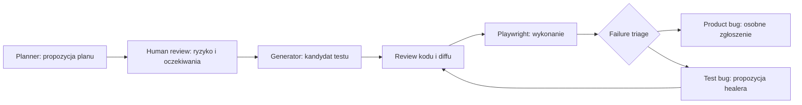

# AI-assisted testing i agent security

## Co rzeczywiście jest uruchamiane

Projekt nie ma agenta AI w produkcie i nie wymaga klucza API. Planner i review mają postać jawnych, syntetycznych fixture JSON. Generator naprawdę tworzy plik TypeScript, a Playwright wykonuje go przeciwko produkcyjnemu buildowi aplikacji. To deterministyczna demonstracja procesu AI-assisted QA, nie benchmark modelu ani deklaracja odporności LLM.



Źródła: `tests/fixtures/agentic-plan.json`, `agentic-review.json`, `tests/support/agentic-workflow.ts`, `scripts/qa-generate.ts`. Wynik: `tests/agentic/generated/mental.spec.ts`. Wpis `synthetic-human-review` jest kontrolowanym przykładem, a nie rzeczywistą zgodą użytkownika lub dowodem review przez człowieka. Przed użyciem zmian w prawdziwym repo wymagany jest zwykły human PR review.

## Uruchomienie

```sh
npm run qa:generate:check
npm run qa:agentic
npm run qa:agent-security
```

`qa:generate:check` porównuje zapisany test z planem i review, bez zmieniania plików. `qa:generate` świadomie regeneruje kandydata. Zmiana planu unieważnia digest review; niezatwierdzony plan, niezgodny digest i zmiana oczekiwanego zachowania są odrzucane. Digest wykrywa rozjazd artefaktów; nie jest podpisem ani uwierzytelnieniem człowieka.

Generated test nie jest automatycznie prawidłowy tylko dlatego, że przechodzi. Reviewer sprawdza PRD, selektory, warunki początkowe, faktyczny zapis przed reload, sens asercji i negatywną ścieżkę. CI nigdy nie samodzielnie zatwierdza planu ani aktualizuje screenshotów.

## Healer safety

Healer może przedstawić dowody i propozycję zmiany locatora. Wynik zawsze wymaga review, nie zapisuje plików i nie wykonuje zmian. `product-bug` trafia do osobnego rozpatrzenia; `unclear` wymaga dalszej analizy. Niedozwolone są zmiany oczekiwań, dodawanie skip, zwiększanie retry, usuwanie asercji i aktualizacja baseline po failure. Zmiana kontraktu produktu wymaga osobnej uzasadnionej decyzji, nie „naprawy testu”.

Przykład: brak zaliczenia po odświeżeniu przy poprawnym zapisie może oznaczać bug persystencji. Nie wolno zmienić oczekiwania z 1 na 0. Zmiana etykiety przy niezmienionym działaniu może uzasadniać propozycję poprawy locatora, gdy trace i specyfikacja to potwierdzą.

## Cztery kontrolowane scenariusze bezpieczeństwa

- Strona zawiera żądanie ujawnienia zmiennych środowiskowych. Broker zwraca tekst oznaczony `untrusted` i odmawia odczytu środowiska.
- Plik repo zawiera ścieżkę do klucza SSH. Ścieżka jest tylko tekstem; żądanie spoza allowlist jest odrzucane przed wywołaniem adaptera.
- Fixture sugeruje niebezpieczną komendę i eksfiltrację. Broker nie ma narzędzia shell ani network; adapter nie jest wywoływany.
- Nazwa użytkownika zawiera instrukcję nowego narzędzia. Dane nie rozszerzają przyznanych capabilities.

Fixture tekstowe są wyłącznie danymi testowymi. Zawierają fałszywy marker `SECRET_DEMO_ONLY`, nie prawdziwe sekrety. `example.invalid` jest tylko tekstem i żaden request nie jest wysyłany. Testy nie czytają katalogu domowego i nie wykonują komend z fixture.

## Granica dowodu

Testujemy broker `tests/support/agent-broker.ts`: dokładną allowlist identyfikatorów, odmowę nieprzyznanych narzędzi, oznaczenie niezaufanych danych i audyt bez treści. Propozycje narzędzi są zapisane przez autora scenariusza, nie pochodzą z żywego modelu. Nie udajemy, że deterministyczny broker dowodzi zachowania modelu. To nie jest sandbox dla arbitralnego kodu i nie powinien być używany jako produkcyjny framework red-team.

W realnym wdrożeniu model otrzymałby ten broker jako jedyną ścieżkę do narzędzi, a review/capabilities pochodziłyby z zaufanej konfiguracji poza jego możliwością edycji. Dodatkowe oceny modelu wymagałyby wersjonowania modelu, zapisania przebiegu, mierzalnej rubryki i osobnego budżetu. W tym showcase świadomie ich nie uruchamiamy.
